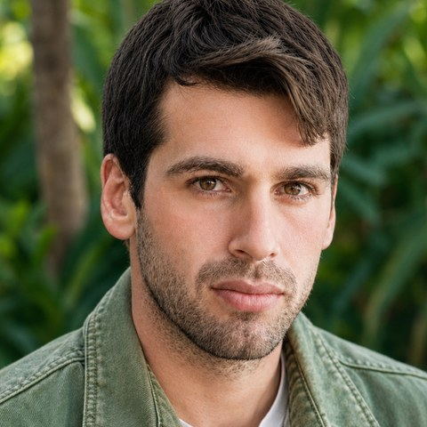
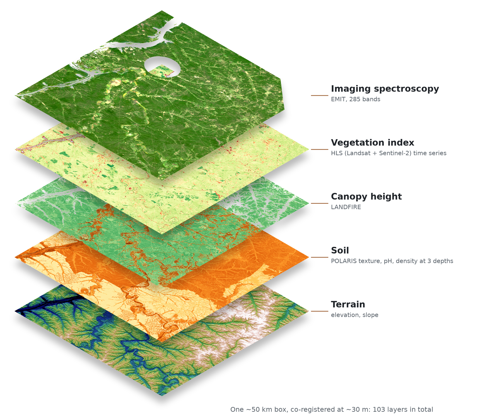
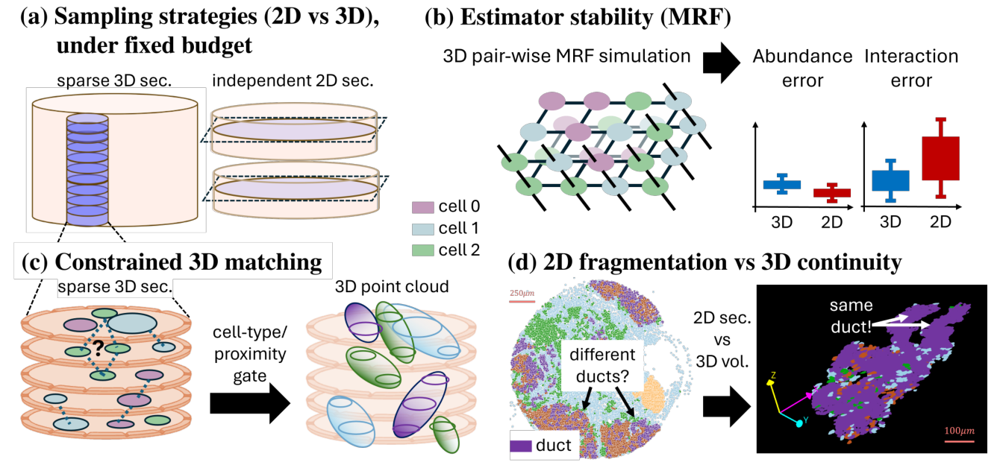
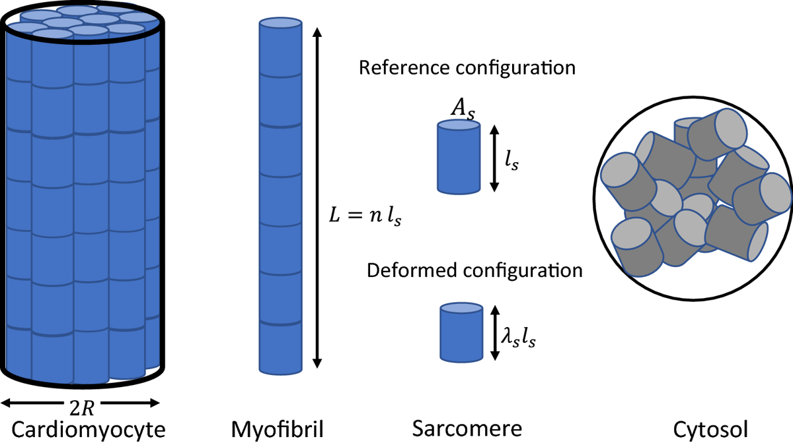

# Ido Harlev

**PhD · Computational Biology · Weizmann Institute of Science & NASA Goddard Space Flight Center**

I am a **geospatial data scientist** working with **high-resolution, multiplexed spatial data**. My path runs from the mechanics of soft materials, through 3D spatial analysis of tissue, to Earth-system science. The question stays the same: how do you recover real structure from spatially sampled, multi-layer measurements?

---

## 🌍 Earth–plant–climate · NASA Goddard & Weizmann (2026–present)

With **Dr. Andrew Feldman** (NASA Goddard) and **Prof. Tamir Klein** (Weizmann). Stacking imaging spectroscopy, satellite time series, climate and land-use layers into reproducible pipelines, and using machine learning to study vegetation, climate interactions and ecosystem resilience.

*Multiplexed geospatial data for one forest box: independent datasets co-registered at ~30 m and analysed together.*

## 🔬 Cancer and spatial proteomics · KerenLab, Weizmann (2023–2025)

With **Dr. Leeat Keren**, in collaboration with Dr. Shai Bagon. One 2D section recovers global cell-type abundance well, but local statistics such as clustering and cell–cell interactions vary widely. I built a module that links cells across serial sections and recovers 3D structure under a fixed imaging budget.

*Figure 1 of the paper: 2D sampling fragments tissue structures that 3D reconstruction restores.*

**Harlev I., Oukhanov T., Ben-Uri R., Keren L., Bagon S.** *Sampling-Aware 3D Spatial Analysis in Multiplexed Imaging.* CVPR 2026 Workshops (CVMI). [CVPR paper](https://openaccess.thecvf.com/content/CVPR2026W/CVMI/html/Harlev_Sampling-Aware_3D_Spatial_Analysis_in_Multiplexed_Imaging_CVPRW_2026_paper.html)
Best Poster, *Breaking New Methodologies in Biomedical Research*, Weizmann Institute, 2025.

## ⚙️ Materials science · Soft Materials Lab, Technion (2019–2021)

With **Noy Cohen**. A thermodynamics-based model of how heart muscle cells remodel under mechanical and hormonal cues. Boundary conditions strongly shape the response, which may help explain how eccentric and concentric hypertrophy differ.

*Model scales, from the whole cell to the sarcomere and cytosol (Fig. 1 of the paper).*

**Harlev I., Holmes J.W., Cohen N.** *The influence of boundary conditions and protein availability on the remodeling of cardiomyocytes.* Biomechanics and Modeling in Mechanobiology 21(1), 189–201, 2022. [DOI](https://doi.org/10.1007/s10237-021-01526-5)

---

**Education:** PhD Computational Biology (in progress), Weizmann & NASA Goddard · MSc Bioinformatics, Weizmann · BSc Materials Engineering and Physics, Technion

[Website](https://idoharlev.github.io) · [Email](mailto:harlev.ido@gmail.com)
